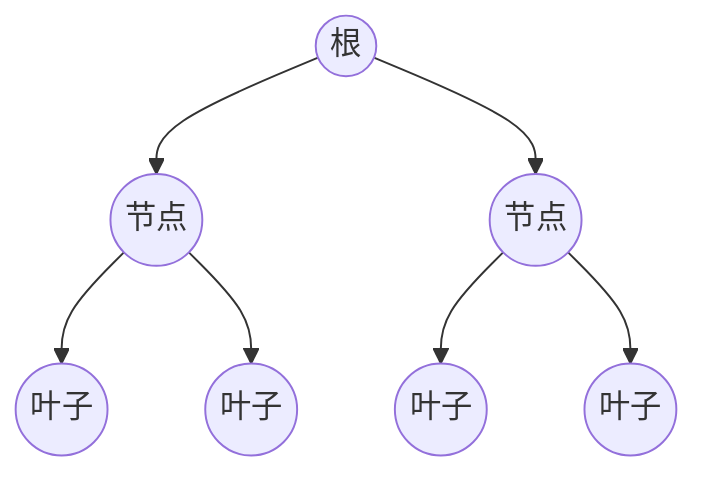
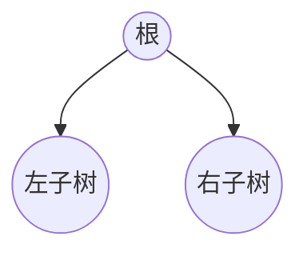
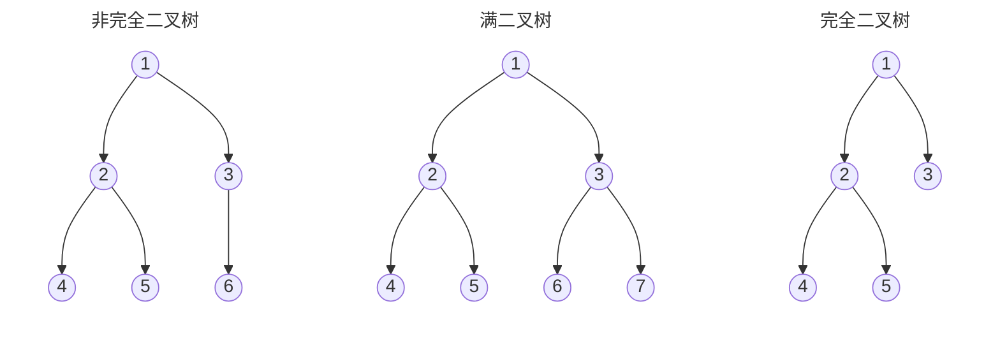
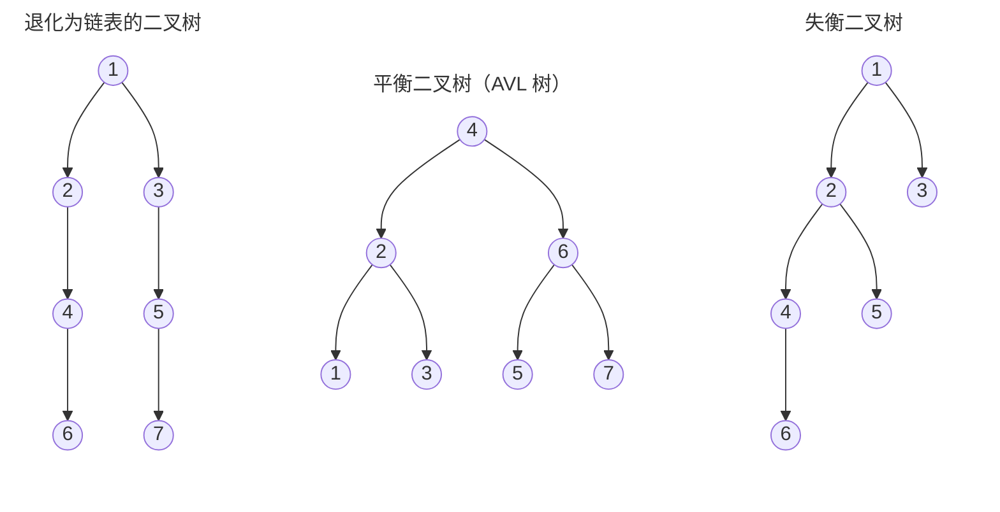
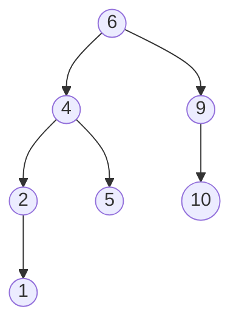
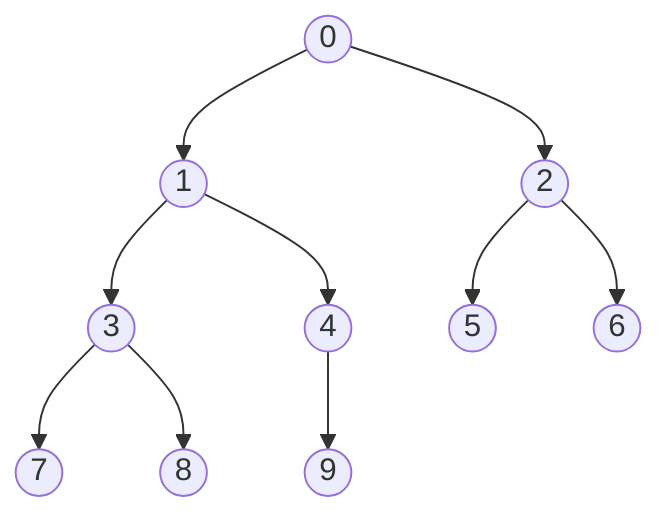

## 1.概述

**树**（Tree）是一种**非线性结构**，由 `n（n ≥ 1）` 个有限节点组成的、具有**层次关系**的集合。之所以叫"树"，是因为它看起来像一棵**倒挂的树**——根朝上、叶朝下。



树的特点：

1. 每个节点有零个或多个**子节点**
2. 没有父节点的节点称为**根节点**
3. 每个非根节点有且只有一个**父节点**
4. 除根节点外，每个子节点都可以分为多个**不相交的子树**

## 2.术语

| 术语 | 含义 |
|:---:|:---:|
| 节点的度 | 一个节点含有的子节点个数 |
| 树的度 | 树中所有节点的度的最大值 |
| 叶节点（终端节点） | 度为零的节点 |
| 父节点（父亲节点） | 含有子节点的节点，为其子节点的父节点 |
| 子节点（孩子节点） | 一个节点的子树的根节点，称为该节点的子节点 |
| 兄弟节点 | 具有相同父节点的节点 |
| 节点的层次 | 从根开始定义，根为第 1 层，子节点依次递增 |
| 树的高度（深度） | 树中节点的最大层次 |
| 堂兄弟节点 | 父节点在同一层的节点 |
| 节点的祖先 | 从根到该节点路径上的所有节点 |
| 子孙 | 以某节点为根的子树中的任意节点 |
| 森林 | 由 `m（m ≥ 0）` 棵互不相交的树组成的集合 |

## 3.树的应用场景

1. xml，html等，那么编写这些东西的解析器的时候，不可避免用到树
2. 路由协议就是使用了树的算法
3. mysql数据库索引
4. 文件系统的目录结构
5. 所以很多经典的AI算法其实都是树搜索，此外机器学习中的decision tree也是树结构

## 4.树的种类

按子节点之间是否有顺序，树可分为两类：

- **无序树**（自由树）：树中任意节点的子节点之间没有顺序关系
- **有序树**：树中任意节点的子节点之间有顺序关系

常见树的种类：

- **二叉树**：每个节点最多含有**两个子树**的树
- **霍夫曼树**（哈夫曼树，用于信息编码）：带权路径最短的二叉树，也称**最优二叉树**
- **B 树**：对读写操作优化的**自平衡查找树**，能保持数据有序，且拥有多于两个的子树

## 5.二叉树

### 5.1 概念

**二叉树**（Binary Tree）是每个节点最多有**两个子树**的树结构，子树分为**左子树**（Left Subtree）和**右子树**（Right Subtree）。



### 5.2 性质

二叉树的重要性质：

1. **性质 1**：二叉树的第 `i` 层上至多有 **2<sup>i-1</sup>** 个节点（`i > 0`）。例如第 3 层最多 **2<sup>3-1</sup> = 4** 个节点
2. **性质 2**：深度为 `k` 的二叉树至多有 **2<sup>k</sup> - 1** 个节点（`k > 0`）。例如深度为 3 时最多 **2<sup>3</sup> - 1 = 7** 个节点
3. **性质 3**：任意二叉树中，叶节点数为 **N<sub>0</sub>**、度为 2 的节点数为 **N<sub>2</sub>**，则 **N<sub>0</sub> = N<sub>2</sub> + 1**
4. **性质 4**：有 `n` 个节点的完全二叉树，其深度 h 必为 **`⌊log₂n⌋ + 1`**
5. **性质 5**：完全二叉树从上到下、从左到右编号后，编号为 `i` 的节点：
   - 左孩子编号为 **`2i`**
   - 右孩子编号为 **`2i + 1`**
   - 父节点编号为 **`i // 2`**（`i = 1` 时为根节点，无父节点）

## 6.二叉树的种类

### 6.1 满二叉树与完全二叉树

**满二叉树**：所有**叶节点都在最底层**的二叉树。

**完全二叉树**：假设深度为 `d`（`d > 1`），除第 `d` 层外其余各层节点数都达到**最大值**，且第 `d` 层所有节点**从左向右连续**排列的二叉树。

::: tip 说明
满二叉树是所有叶节点都在最底层的完全二叉树，即**满二叉树是完全二叉树的特殊情况**。
:::

三种形态的对比示意图：



### 6.2 平衡二叉树（AVL 树）

**任意节点**的两棵子树**高度差不大于 1** 的二叉树。

**作用**：防止树**退化为链表**，保证查找效率。

三种形态的对比示意图（中间为正确形态）：



### 6.3 排序二叉树（BST）

**排序二叉树**（二叉查找树 / 二叉搜索树 / 有序二叉树）的要求：

1. 若左子树不空，左子树上**所有节点**的值均**小于**它的根节点的值
2. 若右子树不空，右子树上**所有节点**的值均**大于**它的根节点的值
3. 左、右子树也**分别**为二叉排序树

一棵满足上述条件的排序二叉树示例（每个节点满足**左小右大**）：



::: tip 备注
- 一般简称为**二叉排序树**
- **中序遍历**排序二叉树，会得到一个**有序序列**
- 空树也是二叉排序树
:::

### 6.4 各自作用

| 类型 | 作用 |
|:---:|:---:|
| 满二叉树 | 层次存储时，从左到右控制节点的产生 |
| 平衡二叉树 | 防止树退化为链表 |
| 排序二叉树 | 对数据排序，检索速度快 |

## 7.二叉树的存储

二叉树有两种存储方式：**顺序存储**和**链式存储**。

### 7.1 顺序存储

按层次从上到下、从左到右，将节点存入**固定大小的数组**。

- **优点**：遍历速度快
- **缺点**：占用空间较大（对不完整的二叉树会浪费空间），**不是主流**存储方式

### 7.2 链式存储

每个节点用一个对象存储**数据**和**左右孩子**的引用。

- 节点个数无法预先确定，链式存储更**灵活**
- 由于子节点个数最多为 2，常见的树都可以转换成二叉树处理
- 二叉树通常采用**链式存储**

## 8.完全二叉树的代码实现

### 8.1 节点类

```python title = "05.自定义代码模拟二叉树.py"
class Node:
    """
    自定义Node类，表示二叉树的节点
    """

    def __init__(self, item=None):
        """
        初始化属性
        :param item: 元素域：即节点存储的数据
        """
        self.item = item
        self.left = None
        self.right = None
```

### 8.2 二叉树类

```python title = "05.自定义代码模拟二叉树.py"
class BinaryTree:
    """
    自定义BinaryTree类，表示二叉树
    """

    def __init__(self, node: Node = None):
        """
        初始化属性
        :param node: 根节点，类似于self.head头节点
        """
        self.root = node

    def add(self, item: Node):
        """
        定义add函数，表示添加节点
        :param item: 要添加的节点
        """
        pass

    def breadth_travel(self):
        """
        广度优先遍历（逐层遍历）
        """
        pass

    def pre_order_travel(self):
        """
        深度优先之先序遍历
        """
        pass

    def in_order_travel(self):
        """
        深度优先之中序遍历
        """
        pass

    def post_order_travel(self):
        """
        深度优先之后序遍历
        """
        pass
```

### 8.3 测试节点和二叉树

```python title = "05.自定义代码模拟二叉树.py"
def dm01_测试节点和二叉树():
    """
    测试节点与二叉树
    :return:
    """
    # 创建节点
    node1 = Node("A")

    # 打印节点的元素域、左子树、右子树
    print(node1.item)  # A
    print(node1.left)  # Node
    print(node1.right)  # Node
    print("-" * 23)

    # 测试二叉树
    # bt = BinaryTree()     # 空的
    # print(bt.root)        # None

    bt = BinaryTree(node1)
    print(bt.root)  # 根节点（的地址）
    print(bt.root.item)  # 根节点的元素域 -> A

if __name__ == '__main__':
    dm01_测试节点和二叉树()
```

运行结果:

```
A
None
None
-----------------------
<__main__.Node object at 0x0000021EF4626F90>
A
```

### 8.4 添加节点

#### 8.4.1 思路

- **初始操作**：初始化队列、将根节点入队、准备要加入的新节点
- **重复执行**：
  1. 获得并弹出队头元素
  2. 若当前节点的左右子树都**不为空** → 将其左右子树入队，继续
  3. 若当前节点有**空闲子树** → 将新节点挂到空的左子树或右子树上，结束

Python 中可用**列表模拟队列**（`append` 入队、`pop(0)` 出队）：

```python title = "05.自定义代码模拟二叉树.py"
def dm02_模拟队列获取元素():
    # 1.创建队列，特点：先进先出
    queue = []

    # 2.模拟往队列中添加元素
    queue.append("A")
    queue.append("B")
    queue.append("C")

    # 3.模拟从队列中取出元素
    print(queue.pop(0))  # 删除索引为0的元素，并返回该元素，即：模拟从队列中获取元素

    print(queue)

if __name__ == '__main__':
    dm02_模拟队列获取元素()
```

运行结果:

```
A
['B', 'C']
```

#### 8.4.2 添加节点代码实现

```python title = "05.自定义代码模拟二叉树.py"
def add(self, item):
    """
    定义add函数，表示添加节点
    :param item: 要添加的节点
    """
    # 1.把item封装成节点
    new_node = Node(item)

    # 2.判断根节点是否为空，如果为空，设置当前节点为根节点
    if self.root is None:
        self.root = new_node
        return

    # 3.创建队列，添加根节点到队列中
    queue: list[Node] = [self.root]

    # 4.通过死循环，找到空缺的节点位置
    while True:
        # 5.获取队列的第1个元素
        node = queue.pop(0)

        # 6.判断当前节点的左子树是否为空
        if node.left is not None:
            # 走这里说明左子树不为空，把当前节点的左子树添加到队列中
            queue.append(node.left)
        else:
            # 走这里说明左子树为空，把新节点设置为当前节点的左子树后结束
            node.left = new_node
            return

        # 7.判断当前节点的右子树是否为空
        if node.right is not None:
            # 走这里说明右子树不为空，把当前节点的右子树添加到队列中
            queue.append(node.right)
        else:
            # 走这里说明右子树为空，把新节点设置为当前节点的右子树后结束
            node.right = new_node
            return
```

### 8.5 广度优先遍历

```python title = "05.自定义代码模拟二叉树.py"
def breadth_travel(self):
    """
    广度优先遍历（逐层遍历）
    """
    # 1.判断根节点是否为空
    if self.root is None:
        return

    # 2.创建队列，添加根节点到队列中
    queue: list[Node] = [self.root]

    # 3.循环打印内容，只要队列不为空，就一直遍历
    while len(queue) > 0:
        # 4.获取队列的第一个元素
        node = queue.pop(0)
        # 5.打印该节点的元素域
        print(node.item, end=" ")

        # 6.判断当前节点的左子树是否存在，存在就添加到队列中
        if node.left is not None:
            queue.append(node.left)

        # 7.判断当前节点的右子树是否存在，存在就添加到队列中
        if node.right is not None:
            queue.append(node.right)

if __name__ == '__main__':
    # 1.创建二叉树对象
    bt = BinaryTree()

    # 2.添加元素
    bt.add("A")
    bt.add("B")
    bt.add("C")
    bt.add("D")
    bt.add("E")
    bt.add("F")
    bt.add("G")
    bt.add("H")
    bt.add("I")
    bt.add("J")

    # 3.广度优先遍历
    bt.breadth_travel()
```

运行结果:

```
A B C D E F G H I J
```

### 8.6 三种深度优先遍历

以添加了节点 `0~9` 的完全二叉树为例（编号即**层次遍历**顺序，`节点 i` 的左孩子为 `2i+1`、右孩子为 `2i+2`）：



深度优先遍历分三种，区别在于**访问根节点的时机**：

| 遍历方式 | 访问顺序 | 本例结果 |
|:---:|:---:|:---:|
| 先序遍历 | 根 → 左 → 右 | `0, 1, 3, 7, 8, 4, 9, 2, 5, 6` |
| 中序遍历 | 左 → 根 → 右 | `7, 3, 8, 1, 9, 4, 0, 5, 2, 6` |
| 后序遍历 | 左 → 右 → 根 | `7, 8, 3, 9, 4, 1, 5, 6, 2, 0` |

::: tip 记忆口诀
- 先序：**根左右**
- 中序：**左根右**
- 后序：**左右根**
:::

```python title = "05.自定义代码模拟二叉树.py"
def pre_order_travel(self, root):
    """
    深度优先之先序遍历
    """
    # 1.判断根节点是否不为空，不为空就打印
    if root is not None:
        # 2.打印根节点的元素域
        print(root.item, end=" ")
        # 3.递归遍历左子树
        self.pre_order_travel(root.left)
        # 4.递归遍历右子树
        self.pre_order_travel(root.right)


def in_order_travel(self, root):
    """
    深度优先之中序遍历
    """
    # 1.判断根节点是否不为空，不为空就打印
    if root is not None:
        # 2.递归遍历左子树
        self.in_order_travel(root.left)
        # 3.打印根节点的元素域
        print(root.item, end=" ")
        # 4.递归遍历右子树
        self.in_order_travel(root.right)


def post_order_travel(self, root):
    """
    深度优先之后序遍历
    """
    # 1.判断根节点是否不为空，不为空就打印
    if root is not None:
        # 2.递归遍历左子树
        self.post_order_travel(root.left)
        # 3.递归遍历右子树
        self.post_order_travel(root.right)
        # 4.打印根节点的元素域
        print(root.item, end=" ")

def dm04_深度优先遍历():
    # 1.创建二叉树对象
    bt = BinaryTree()

    # 2.添加元素
    bt.add(0)
    bt.add(1)
    bt.add(2)
    bt.add(3)
    bt.add(4)
    bt.add(5)
    bt.add(6)
    bt.add(7)
    bt.add(8)
    bt.add(9)

    # 先序遍历
    print("先序（根左右）：", end=" ")
    bt.pre_order_travel(bt.root)

    # 中序遍历
    print("\n中序（左根右）：", end=" ")
    bt.in_order_travel(bt.root)

    # 后序遍历
    print("\n后序（左右根）：", end=" ")
    bt.post_order_travel(bt.root)

if __name__ == '__main__':
    dm04_深度优先遍历()
```

运行结果:

```
先序（根左右）： 0 1 3 7 8 4 9 2 5 6
中序（左根右）： 7 3 8 1 9 4 0 5 2 6
后序（左右根）： 7 8 3 9 4 1 5 6 2 0
```

### 8.7 完整代码

```python title = "05.自定义代码模拟二叉树.py"
class Node:
    """
    自定义Node类，表示二叉树的节点
    """

    def __init__(self, item=None):
        """
        初始化属性
        :param item: 元素域：即节点存储的数据
        """
        self.item = item
        self.left = None
        self.right = None


class BinaryTree:
    """
    自定义BinaryTree类，表示二叉树
    """

    def __init__(self, node: Node = None):
        """
        初始化属性
        :param node: 根节点，类似于self.head头节点
        """
        self.root = node

    def add(self, item):
        """
        定义add函数，表示添加节点
        :param item: 要添加的节点
        """
        # 1.把item封装成节点
        new_node = Node(item)

        # 2.判断根节点是否为空，如果为空，设置当前节点为根节点，
        if self.root is None:
            self.root = new_node
            return

        # 3.创建队列，添加根节点到队列中
        queue: list[Node] = [self.root]

        # 4.通过死循环，找到空缺的节点位置
        while True:
            # 5.获取队列的第1个元素
            node = queue.pop(0)

            # 6.判断当前节点的左子树是否为空
            if node.left is not None:
                # 走这里说明左子树不为空，把当前节点的左子树添加到队列中
                queue.append(node.left)
            else:
                # 走这里说明左子树为空，把新节点设置为当前节点的左子树后结束
                node.left = new_node
                return

            # 7.判断当前节点的右子树是否为空
            if node.right is not None:
                # 走这里说明右子树不为空，把当前节点的右子树添加到队列中
                queue.append(node.right)
            else:
                # 走这里说明右子树为空，把新节点设置为当前节点的右子树后结束
                node.right = new_node
                return

    def breadth_travel(self):
        """
        广度优先遍历（逐层遍历）
        """
        # 1.判断根节点是否为空
        if self.root is None:
            return

        # 2.创建队列，添加根节点到队列中
        queue: list[Node] = [self.root]

        # 3.循环打印内容，只要队列不为空，就一直遍历
        while len(queue) > 0:
            # 4.获取队列的第一个元素
            node = queue.pop(0)
            # 5.打印该节点的元素域
            print(node.item, end=" ")

            # 6.判断当前节点的左子树是否存在，存在就添加到队列中
            if node.left is not None:
                queue.append(node.left)

            # 7.判断当前节点的右子树是否存在，存在就添加到队列中
            if node.right is not None:
                queue.append(node.right)

    def pre_order_travel(self, root):
        """
        深度优先之先序遍历
        """
        # 1.判断根节点是否不为空，不为空就打印
        if root is not None:
            # 2.打印根节点的元素域
            print(root.item, end=" ")
            # 3.递归遍历左子树
            self.pre_order_travel(root.left)
            # 4.递归遍历右子树
            self.pre_order_travel(root.right)


    def in_order_travel(self, root):
        """
        深度优先之中序遍历
        """
        # 1.判断根节点是否不为空，不为空就打印
        if root is not None:
            # 2.递归遍历左子树
            self.in_order_travel(root.left)
            # 3.打印根节点的元素域
            print(root.item, end=" ")
            # 4.递归遍历右子树
            self.in_order_travel(root.right)

    def post_order_travel(self, root):
        """
        深度优先之后序遍历
        """
        # 1.判断根节点是否不为空，不为空就打印
        if root is not None:
            # 2.递归遍历左子树
            self.post_order_travel(root.left)
            # 3.递归遍历右子树
            self.post_order_travel(root.right)
            # 4.打印根节点的元素域
            print(root.item, end=" ")


def dm01_测试节点和二叉树():
    # 创建节点
    node1 = Node("A")

    # 打印节点的元素域、左子树、右子树
    print(node1.item)  # A
    print(node1.left)  # Node
    print(node1.right)  # Node
    print("-" * 23)

    # 测试二叉树
    # bt = BinaryTree()     # 空的
    # print(bt.root)        # None

    bt = BinaryTree(node1)
    print(bt.root)  # 根节点（的地址）
    print(bt.root.item)  # 根节点的元素域 -> A


def dm02_模拟队列获取元素():
    # 1.创建队列，特点：先进先出
    queue = []

    # 2.模拟往队列中添加元素
    queue.append("A")
    queue.append("B")
    queue.append("C")

    # 3.模拟从队列中取出元素
    print(queue.pop(0))  # 删除索引为0的元素，并返回该元素，即：模拟从队列中获取元素

    print(queue)


def dm03_广度优先遍历():
    # 1.创建二叉树对象
    bt = BinaryTree()

    # 2.添加元素
    bt.add("A")
    bt.add("B")
    bt.add("C")
    bt.add("D")
    bt.add("E")
    bt.add("F")
    bt.add("G")
    bt.add("H")
    bt.add("I")
    bt.add("J")

    # 3.广度优先遍历
    bt.breadth_travel()


def dm04_深度优先遍历():
    # 1.创建二叉树对象
    bt = BinaryTree()

    # 2.添加元素
    bt.add(0)
    bt.add(1)
    bt.add(2)
    bt.add(3)
    bt.add(4)
    bt.add(5)
    bt.add(6)
    bt.add(7)
    bt.add(8)
    bt.add(9)

    # 先序遍历
    print("先序（根左右）：", end=" ")
    bt.pre_order_travel(bt.root)

    # 中序遍历
    print("\n中序（左根右）：", end=" ")
    bt.in_order_travel(bt.root)

    # 后序遍历
    print("\n后序（左右根）：", end=" ")
    bt.post_order_travel(bt.root)

if __name__ == '__main__':
    # dm01_test_node_and_binary_tree()

    # dm02_模拟队列获取元素()

    # dm03_广度优先遍历()

    dm04_深度优先遍历()
```

## 9.逆推二叉树结构

已知一棵二叉树的**先序遍历**和**中序遍历**，可以唯一逆推出它的结构：

1. **先序**的第一个元素是**根节点**
2. 在**中序**中找到根节点，其左边元素全是**左子树**的节点、右边元素全是**右子树**的节点
3. 分别对左、右子树**重复步骤 1、2**，直到全部划分完毕

::: tip 举例
第 8.6 节的树：先序 `0, 1, 3, 7, 8, 4, 9, 2, 5, 6`、中序 `7, 3, 8, 1, 9, 4, 0, 5, 2, 6`。

先序第一个 `0` 是根节点；中序里 `0` 左边 `7, 3, 8, 1, 9, 4` 是左子树、右边 `5, 2, 6` 是右子树；继续对左右子树划分，即可还原整棵树。
:::    
